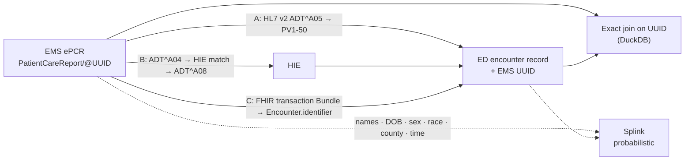

# EMS–ED Linkage Lab

**Simulating how a non-identifying EMS UUID can travel into the emergency-department record — and what
deterministic UUID linkage enables compared with probabilistic matching — for motor-vehicle-crash and
fall injuries.**

> ⚠️ **Synthetic data — for demonstration only.** Every record is generated by code in this repository
> with a fixed random seed. No real patients, EMS agencies, hospitals or HIEs are represented.
>
> **Independent portfolio project. Not affiliated with, endorsed by, or produced for the CDC, NHTSA,
> NEMSIS, or any agency. All data are synthetic.**

[](https://github.com/saikurmana/ems-ed-linkage-lab/actions/workflows/ci.yml)
· Site: <https://saikurmana.github.io/ems-ed-linkage-lab/> · App: `APP_URL` (placeholder — run locally with `make app`)

## Practical takeaway

**Carry the EMS UUID into the ED record, and keep probabilistic matching as a fallback.** In this
simulation, joining on the UUID first and running Splink only on the records the UUID missed linked
**99.1%** of true EMS→ED transports at **99.7%** precision *(synthetic data)* — more than the UUID alone
(91.7%, Pattern C, *synthetic*) or probabilistic matching alone (88.9%, *synthetic*).

Why not probabilistic matching alone? Because what it misses is not random:

- **The most severely injured are the ones it misses.** For *critical* injuries, Splink linked
  **31.2%** of transports vs **92.0%** for the UUID and **94.7%** for the hybrid *(synthetic data)* —
  unidentified EMS patients and ED trauma aliases leave nothing to match on.
- **That shifts the answers.** Among EMS patients with high-risk field-triage criteria, the share
  admitted, transferred or died is **76.3%** with ground-truth links, **75.8%** with hybrid links,
  **76.5%** with UUID links and **66.6%** with Splink links *(synthetic data; descriptive demonstration)*.

And why not the UUID alone? Because integration loses some UUIDs — and if it loses them unevenly
(e.g., rural / small agencies connected later), UUID-only recall becomes unequal too. See the
[sensitivity check](#does-flat-recall-hold-sensitivity-check) below.

## The problem

Injury information is split across systems. The EMS electronic patient care report (ePCR) knows the
mechanism, scene, times, vitals, field-triage criteria and alcohol/drug indicators; the hospital ED
record knows diagnoses and disposition. Answering "what happened to the patients EMS triaged as
high-risk?" needs both — and today they are usually joined after the fact by **probabilistic matching**
on names, birth dates and times, often months or years later.

Analogy: probabilistic linkage is like reuniting luggage with travelers by describing the bag
("black, medium, red ribbon"). It mostly works — until the bag is generic, the description is wrong,
or the traveler is unconscious and registered as "TRAUMA, ZULU". A carried UUID is the luggage tag.

## What this demonstrates

1. **A synthetic world** (`synth/`): 12,000 synthetic MVC and fall injury events → EMS ePCR records (UUID v4 per
   report, county-level location, times, vitals, NEMSIS-labelled trauma criteria and alcohol/drug
   indicators, procedures) → ED encounters (arrival lag, ICD-10-CM codes, disposition), including
   non-transported EMS calls and ED visits with no EMS record. Demographic errors (typos, name variants,
   DOB errors, unknown/misclassified race and ethnicity, unidentified patients, trauma aliases) are
   injected at **higher rates for some subgroups**. Ground truth is held separately.
2. **Three integration patterns** (`patterns/`) that carry — or lose — the UUID, with configurable failure rates:
   - **A · Point-to-point HL7 v2** — ePCR sends `ADT^A05`; the UUID lands in the ED record's **PV1-50 (Alternate Visit ID)**.
   - **B · HIE intermediary** — EMS and ED `ADT^A04` messages are matched by the HIE, which writes the UUID back with `ADT^A08`.
   - **C · FHIR R4 API** — an integration service adds an **`Encounter.identifier`** with its own system URI; bundles validated with `fhir.resources`.
3. **Linkage comparison** (`linkage/`): deterministic DuckDB joins on the UUID vs **Splink** probabilistic
   linkage (name/DOB/sex/race/county + arrival time or date), plus a hybrid — scored on precision, recall,
   F1, false-match rate, runtime, subgroup recall and (assumed) data latency.
4. **What linkage enables** (`analysis/`): example questions answered under ground-truth, UUID and
   Splink links — demonstrations, not findings.
5. **Streamlit app**, **GitHub Pages site**, and **implementer documentation** (`docs/`).

## Architecture



More diagrams (sequence diagrams for each pattern, pipeline): [docs/architecture.md](docs/architecture.md).

## Quickstart

Python 3.11.

```bash
pip install -r requirements.txt
```

```bash
make data simulate link analyze
```

```bash
make app
```

Also: `make test` (ruff-clean code, pytest incl. FHIR/HL7 validation and the carry-rate regression
test), `make site` (builds `_site/` for GitHub Pages), `make ci` (small end-to-end run in `.ci_run/`).
Outputs are deterministic: fixed seed, sorted exports — re-running produces identical files
(except `results/runtime.json`, which records wall-clock time).

## Deploying the app (Streamlit Community Cloud)

The app reads only committed files (`results/`, `examples/`), so no pipeline run is needed at deploy time.

- **Main file path:** `app/streamlit_app.py`
- **Dependencies:** `requirements.txt` only. It pins `fhir.resources==6.1.0` together with
  `pydantic==1.10.27` (pydantic must stay < 2 for that release).
- **Python version:** choose **3.11** in the app's advanced settings, to match CI and the tested
  environment.
- After deploying, replace the `APP_URL` placeholder in `site_src/site.yaml` and in this README.

## Results (synthetic data — for demonstration only)

### All methods

*Synthetic data — for demonstration only.* 7,738 true EMS→ED transport links; Splink match threshold 0.9;
false-match rate = share of declared links that are wrong.

| Method | Precision | Recall | F1 | False-match rate |
|---|---:|---:|---:|---:|
| Hybrid — Pattern C UUID first, then Splink (time) on the rest | 0.997 | 0.991 | 0.994 | 0.003 |
| Deterministic UUID — Pattern A (HL7 v2 point-to-point) | 1.000 | 0.830 | 0.907 | 0.000 |
| Deterministic UUID — Pattern B (HIE match + write-back) | 1.000 | 0.745 | 0.854 | 0.000 |
| Deterministic UUID — Pattern C (FHIR API identifier) | 1.000 | 0.917 | 0.957 | 0.000 |
| Probabilistic — Splink, name/DOB/sex/race/county + arrival time | 0.995 | 0.889 | 0.939 | 0.005 |
| Probabilistic — Splink, name/DOB/sex/race/county + arrival date only | 0.993 | 0.881 | 0.934 | 0.007 |

- **UUID joins are exact but only as complete as the integration** *(synthetic)*: recall equals the
  configured carry rate (A: 0.92 × 0.97 × 0.93 ≈ 0.830; C: 0.95 × 0.985 × 0.98 ≈ 0.917) — a regression test checks it.
- **Race/ethnicity gaps depend on the data available** *(synthetic)*: with minute-level arrival times,
  Splink recall varied little by race/ethnicity (0.876–0.909); with dates only, Asian patients fell to
  0.793 vs 0.886 for White patients.

### Does flat recall hold? (sensitivity check)

The main result assumes UUID carry fails **at random**. The named scenario
`rural_small_agency_carry_gap` instead assumes — as an **invented, configurable assumption** — that
agencies in rural counties (standing in for small agencies) are less often connected and have less
reliable interfaces (`config/default.yaml → sensitivity`, run with `make sensitivity`).

*Synthetic data — for demonstration only.* Recall by the EMS agency's urbanicity:

| Method | Baseline urban | Baseline rural | Scenario urban | Scenario rural | Scenario gap (pp) |
|---|---:|---:|---:|---:|---:|
| Hybrid (C + Splink) | 0.992 | 0.990 | 0.990 | 0.963 | +2.7 |
| UUID · A (HL7 v2) | 0.828 | 0.834 | 0.830 | 0.532 | +29.8 |
| UUID · B (HIE) | 0.745 | 0.745 | 0.750 | 0.625 | +12.5 |
| UUID · C (FHIR) | 0.916 | 0.918 | 0.917 | 0.666 | +25.0 |
| Splink (time) | 0.889 | 0.889 | 0.889 | 0.889 | -0.1 |

- **Baseline:** recall is flat by urbanicity for every method (gaps ≤ 0.6 pp, *synthetic*) — but only because carry failures were random by construction.
- **Scenario:** UUID-only recall opens a 25–30 pp rural gap for Patterns A and C *(synthetic)*; the
  hybrid narrows it to 2.7 pp because probabilistic matching backfills the rural records the UUID missed.
  Splink alone is unaffected by carry failures.

### Latency (illustrative assumption)

UUID links exist at the encounter. Probabilistic linkage is modelled as an **annual batch N months
after the data year closes** — default N = 18, shown with a 12 / 18 / 24 / 36-month sensitivity range.
No verified public source states a typical end-to-end EMS–ED linkage lag, so N is an assumption. For
context, HCUP reports its State databases are released "typically beginning 9 to 12 months following
the end of a calendar year" ([HCUP FAQ](https://hcup-us.ahrq.gov/tech_assist/faq.jsp); more in
[standards references](docs/standards_references.md#data-release-timing-context-for-latency-assumptions)).

*Synthetic data — for demonstration only.* Share of true links usable for analysis, by months since the encounter:

| Method (assumed lag) | 6 mo | 12 mo | 18 mo | 24 mo | 36 mo | 48 mo |
|---|---:|---:|---:|---:|---:|---:|
| UUID · Pattern C (at the encounter) | 91.7% | 91.7% | 91.7% | 91.7% | 91.7% | 91.7% |
| Splink, batch 12 mo after year end | 0.0% | 0.2% | 43.4% | 88.9% | 88.9% | 88.9% |
| Splink, batch 18 mo after year end (default) | 0.0% | 0.0% | 0.5% | 44.0% | 88.9% | 88.9% |
| Splink, batch 24 mo after year end | 0.0% | 0.0% | 0.0% | 0.2% | 88.9% | 88.9% |
| Splink, batch 36 mo after year end | 0.0% | 0.0% | 0.0% | 0.0% | 0.2% | 88.9% |

Full outputs: [`results/`](results/) · interactive: `make app`.

## Example message snippets

Pattern A — hospital `ADT^A04` carrying the EMS UUID in **PV1-50** ([full file](examples/pattern_a/example_1_hospital_ADT_A04.hl7)):

```text
MSH|^~\&|EHR_SYNTH|H02|DOWNSTREAM|WAREHOUSE|20240425120951||ADT^A04^ADT_A01|H02V0000531-A04|T|2.5.1
EVN|A04|20240425120951
PID|1||H02M0000528^^^H02^MR||JONES^JEREMY||19670705|M||^White||||||||||||^Not Hispanic or Latino
PV1|1|E|ED^^^H02||||||||||||||||H02V0000531^^^H02^VN|||||||||||||||||||||||||20240425120951||||||0008be45-770f-4f0b-be0b-bd3d9fc20513^^^EMSUUID^VN
PV2||||||||||||||||||||||||||||||||||||||A^Ambulance^HL70430
```

Pattern C — FHIR R4 `Encounter.identifier` ([full bundle](examples/pattern_c/example_1_transaction_bundle.json)):

```json
{
  "use": "secondary",
  "type": { "text": "EMS patient care report UUID" },
  "system": "https://ems-ed-linkage-lab.example.org/fhir/sid/ems-pcr-uuid",
  "value": "0008be45-770f-4f0b-be0b-bd3d9fc20513"
}
```

Pattern B messages (EMS→HIE, ED→HIE, HIE write-back): [examples/pattern_b/](examples/pattern_b/).

## Repository layout

```text
config/       default.yaml (all assumptions, seed) · ci.yaml (small run)
synth/        synthetic population, EMS ePCRs, ED encounters, data-quality injection, ground truth
patterns/     A (HL7 v2), B (HIE), C (FHIR R4) + HL7 builder/parser
linkage/      standardisation, DuckDB UUID joins, Splink, evaluation, latency
analysis/     example questions (demonstrations, not findings)
app/          Streamlit explorer (offline, reads results/ and examples/)
site_src/     static site builder (make site → _site/)
docs/         implementation guide, facilitators & barriers, partner map, privacy & security,
              architecture, limitations, standards references
examples/     sample HL7 v2 messages and FHIR bundles
results/      small committed aggregate outputs
tests/        pytest suite
```

## Documentation

- [Architecture & data flows](docs/architecture.md) — including why PV1-50
- [Implementation guide](docs/implementation_guide.md) — reusable template per pattern
- [Facilitators & barriers](docs/facilitators_and_barriers.md) — structured template, simulation-supported vs to-validate
- [Partner map](docs/partner_map.md)
- [Privacy & security](docs/privacy_and_security.md)
- [Limitations](docs/limitations.md)

## Standards references

Every NEMSIS v3.5.0 element, HL7 v2 segment/field/table, FHIR R4 resource/element and ICD-10-CM code
named in this project was checked against an official public source (nemsis.org, hl7.org,
build.fhir.org, terminology.hl7.org, cms.gov). URLs and access dates:
**[docs/standards_references.md](docs/standards_references.md)**. Where an element could not be verified
it is described generically (e.g. simplified procedure labels instead of SNOMED CT codes). The UUID's
HL7 v2 location and FHIR identifier system are documented **local conventions**.

## Disclaimer

Synthetic data — for demonstration only. Independent portfolio project. Not affiliated with, endorsed
by, or produced for the CDC, NHTSA, NEMSIS, or any agency. All data are synthetic. Results describe the
simulation's assumptions, not any real system or population, and are not clinical or policy guidance.

## Author

**Sai Kurmana, MPH, MS, CPHIMS**

License: MIT (see [LICENSE](LICENSE)).
