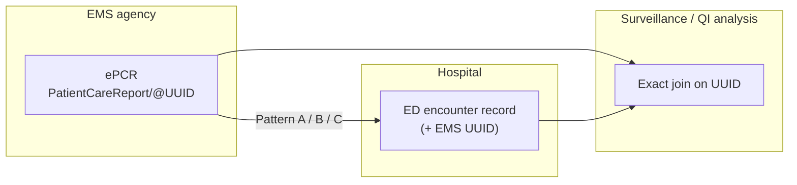
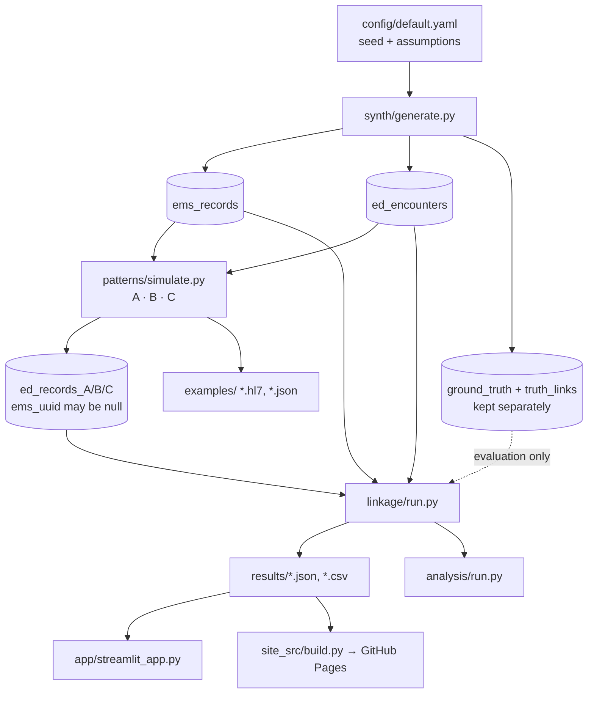
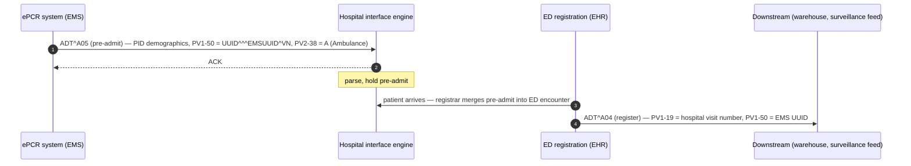
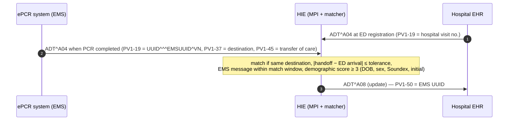
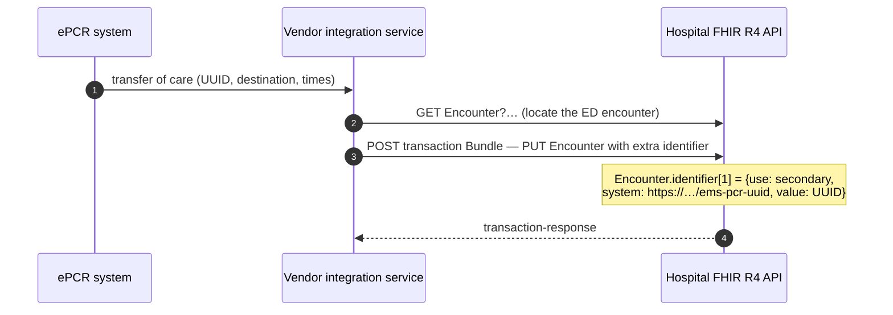
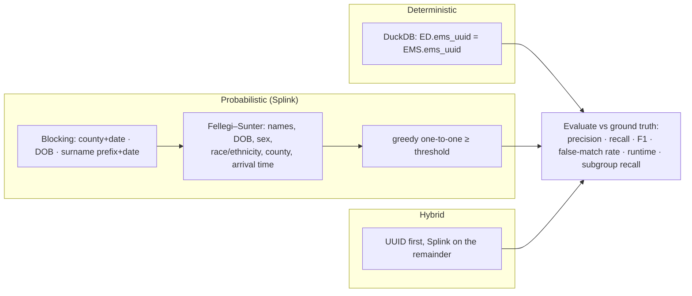

# Architecture and data flows

> Synthetic data — for demonstration only. All agencies, hospitals, HIEs and vendors below are
> generic roles, not real organizations.

## The core idea

NEMSIS v3.5.0 requires a `UUID` attribute on every `PatientCareReport` (see
[standards_references.md](standards_references.md)). The UUID is generated by software, contains no
patient information, and is unique to one EMS encounter. If integration carries that one value into
the hospital's ED encounter record, EMS and ED data can later be joined **exactly** — no names, birth
dates or probabilistic scoring needed for the join itself.



## Pipeline in this repository



The ground truth is never given to a linkage method; it is used only to score them.

## Pattern A — point-to-point HL7 v2



**Simulated failure stages** (`config → patterns.A_point_to_point`): interface not live for the
agency–hospital pair → message not delivered/accepted → registration does not merge the pre-admit
(UUID lost). Expected carry rate = product of pass rates.

### Why PV1-50 (Alternate Visit ID)?

| Option | Assessment |
|---|---|
| **PV1-50 Alternate Visit ID** (CX, repeating) — *chosen* | Encounter-level (the UUID identifies one EMS encounter, not a person). CX lets us name the assigning authority (`EMSUUID`) and type (`VN`), so it cannot be confused with the hospital's own visit number in PV1-19. The HL7 v2-to-FHIR IG maps PV1-50 to an `Identifier` (CX[Identifier]), which lines up with Pattern C's `Encounter.identifier`. |
| PV1-19 Visit Number | Already holds the hospital's own visit number; overloading it would break hospital workflows. (In Pattern B the **EMS** system's own A04 uses PV1-19 for the UUID because there it *is* the EMS visit.) |
| PID-3 Patient Identifier List | Patient-level. Putting an encounter identifier here would wrongly merge or split patient records in an MPI. |
| `ZEM` Z-segment (local) | Acceptable if documented — e.g. `ZEM|1|<uuid>|<agency id>|<pcr number>`. Easy to add, but every receiving system must be configured to read it and many interface engines drop unknown segments by default. Kept as a documented **fallback** for EHRs that cannot store a second visit identifier. |

Either way, the choice is a **local convention** that the state EMS office, hospital and vendors must
agree on and document in the interface specification.

## Pattern B — HIE intermediary



**Simulated failure modes:** EMS or ED message not sent; PCR completed **after** the HIE's match
window closed (ePCR completion delay is lognormal with a long tail); demographic disagreement
(typos, aliases, unknown patients) or ambiguous ties → no match; write-back failure. A matcher that
uses demographics *can* also write back a wrong UUID — the deterministic join downstream would then
reproduce that false link faithfully (none occurred with the default strict rule; loosen it in the
config to see this).

## Pattern C — FHIR R4 API (vendor / integration-service style)



```json
{ "use": "secondary",
  "type": { "text": "EMS patient care report UUID" },
  "system": "https://ems-ed-linkage-lab.example.org/fhir/sid/ems-pcr-uuid",
  "value": "0008be45-770f-4f0b-be0b-bd3d9fc20513" }
```

**Simulated failure stages:** integration not enabled for the agency–hospital pair → API call fails
after retries → identifier not retained by the EHR on later updates.

All bundles (transaction and ED-record collection bundles) are validated with `fhir.resources`
(FHIR R4 4.0.1 models) plus explicit checks of required-binding codes.

## Linkage and evaluation


