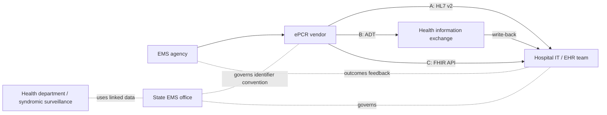

# Partner map

> Synthetic data — for demonstration only. Roles are described generically; no real organization is
> implied. Validate every role and responsibility with real partners.

Analogy: a relay race. The baton (the UUID) is created by EMS, passed through one or more
handlers, and must arrive at the hospital record. Each role below either **carries**, **receives**,
**governs** or **uses** the baton.

| Role | Carries / receives / governs / uses | Patterns | Typical responsibilities | Questions to ask |
|---|---|---|---|---|
| **EMS agency** | creates | A, B, C | complete PCRs promptly; approve data sharing; use outcome feedback for QI | How quickly are PCRs completed after transfer of care? Who signs agreements? |
| **ePCR vendor** | carries | A, B, C | expose the UUID to outbound interfaces; build HL7 v2 / FHIR integrations; monitoring | Can the UUID be sent outside the NEMSIS export? Cost and timeline per connection? |
| **Hospital IT / EHR team** | receives | A, B, C | interface engine routes; store a second visit identifier; preserve it through merges; FHIR client access | Can the ED encounter keep PV1-50 / an extra Encounter.identifier? Does it survive updates? |
| **ED registration / operations** | receives | A | merge EMS pre-arrival records into the ED encounter | What cue tells the registrar which pre-arrival belongs to which patient? |
| **Health information exchange (HIE)** | carries / matches | B | ingest EMS and ED ADT; match; write back; manual review queue | Match window, matching rules, audit process, participation agreements |
| **State EMS office** | governs | all | own the identifier convention (assigning authority / URI); data dictionary; statewide NEMSIS repository | Who documents and versions the convention? |
| **Health department / syndromic surveillance** | uses | all | analysis of linked data for injury prevention; small-cell suppression and release rules | Which questions need linkage? Acceptable latency? |
| **Privacy / legal officers (each party)** | governs | all | agreements, minimum-necessary review, breach procedures | Is writing an external identifier into the record covered? |

Use this table as a stakeholder-mapping worksheet: add a column for named contacts and one for
agreement status when working with real partners.
